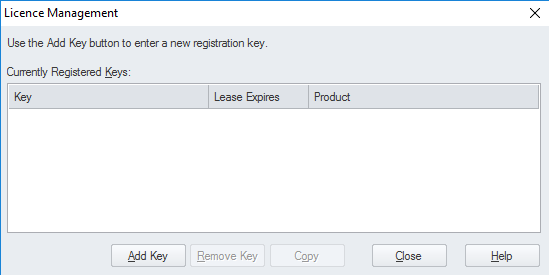
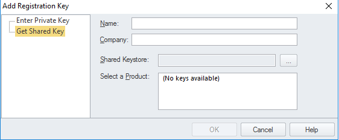
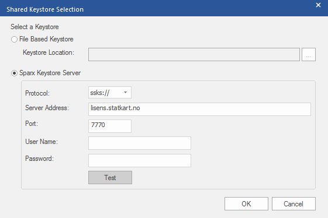
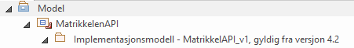
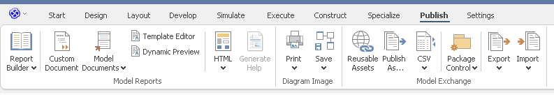
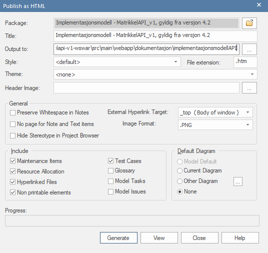

# Repo for implementasjonsmodellen til Matrikkelen

Implementasjonsmodellen til Matrikkelen blir laget med Enterprise Architect.
Når endringer blir gjort i API-et skal implementasjonsmodellen også bli oppdatert, slik at nå-situasjonen til matrikkelen blir gjenspeilet i implementasjonsmodellen.

Det er satt opp en GitHub Action slik at når en PR merges til dette repoet med endringer til implementasjonsmodellen, vil det automatisk lages en PR til matrikkel-repoet hvor implementasjonsmodellen blir lagt ut.

# Enterprise Architect Oppsettguide for Mac og Linux

Denne guiden viser hvordan du setter opp Enterprise Architect på Mac og Linux ved hjelp av Wine.


### 1. Installer Wine

Kjør disse kommandoene i Terminal:

#### Mac

```bash
# Oppdater Homebrew
brew update

# Installer Wine
brew install --cask wine-stable
```
[//]: # (**Merk:** Du vil se advarsler om at Wine ikke passerer macOS Gatekeeper-sjekker. Wine vil bli deaktivert i september 2026, men det vil fungere fint frem til da.)

#### Linux

```bash
# Oppdater apt
sudo apt update

# Installer Wine
sudo apt install wine64
```


### 2. Installer Rosetta 2 (kun Mac med apple-silicon)

Wine på Apple Silicon krever Rosetta 2. Installer det med:

```bash
softwareupdate --install-rosetta --agree-to-license
```

### 3. Godkjenn Wine i macOS Sikkerhetsinnstillinger (kun Mac)

Når du først prøver å kjøre Wine, vil macOS blokkere det med en sikkerhetsadvarsel.


1. Åpne **System Settings** → **Privacy & Security**
2. Rull ned for å finne meldingen om at "Wine Stable" er blokkert
3. Klikk **Open Anyway** eller **Allow Anyway**


### 5. Verifiser Wine-installasjonen

```bash
wine --version
```

Du skal se Wine-versjonsnummeret (f.eks. wine-10.0).

### 6. Sett opp Wine-miljø

Opprett et Wine-prefix (Windows-lignende miljø):

```bash
WINEPREFIX=~/.wine WINEARCH=win64 winecfg
```

Et Wine-konfigurasjonsvindu vil åpne seg. Du kan lukke det etter at det vises - dette initialiserer bare miljøet.

### 7. Installer Enterprise Architect

Installer EA med installeringsfilen som ligger i GitHub-repoet.

```bash
wine easetupfull_x64.msi
```

Hvis det trengs en installasjonsnøkkel så bruker man nøkkelen `TWC6` som er nøkkelen for versjon 10 og senere av EA.

Følg installasjonspromptene som du ville gjort på Windows.

### 8. Kjør Enterprise Architect

Etter installasjonen kan du kjøre EA med:

```bash
wine ~/.wine/drive_c/Program\ Files/Sparx\ Systems/EA/EA.exe
```

**Merk:** `~/.wine/drive_c/Program\ Files/Sparx\ Systems/EA/EA.exe` er default, hvis du har installert Enterprise Architect i en annen mappe i wine, må du endre filstien til der hvor EA.exe ligger.

**Tips:** Opprett et alias i shell-profilen din for enklere tilgang:

```bash
# Zsh
echo 'alias ea="wine ~/.wine/drive_c/Program\ Files/Sparx\ Systems/EA/EA.exe"' >> ~/.zshrc
source ~/.zshrc

# Bash
echo 'alias ea="wine ~/.wine/drive_c/Program\ Files/Sparx\ Systems/EA/EA.exe"' >> ~/.bashrc
source ~/.bashrc
```

Nå kan du bare skrive `ea` for å starte Enterprise Architect.

### 9. Aktiver lisens

Følg instruksjoner i [**Enterprise Architect lisens**](#enterprise-architect-lisens)

### 10. Få tilgang til det lokale filsystemet inni Wine

For at Enterprise Architect (eller andre Windows-programmer) skal kunne få tilgang til filer som ligger på vertssystemet (macOS eller Linux), må du lage en "disk" i Wine som peker til en lokal mappe på vertssystemet ditt som du vil gi Wine tilgang til.


**Åpne Wine-konfigurasjonen:**

   ```bash
   winecfg
   ```
I vinduet som dukker opp, gå til fanen `Drives`.

Klikk `Add...` for å legge til en ny disk (for eksempel `D:`).

Under `Path:`, velg mappen du vil gjøre tilgjengelig for Enterprise Architect:
   
**Linux:**
`/home/<brukernavn>/Documents/<filsti til matrikkel-arkitektur repoet>`

**Macos:**
`/Users/<brukernavn>/Documents/<filsti til matrikkel-arkitektur repoet>`
   
Klikk `Apply` og deretter `OK`.

[//]: # (## Feilsøking)

[//]: # ()
[//]: # (### Wine-problemer)

[//]: # ()
[//]: # (**Problem:** Grafikk- eller visningsproblemer  )

[//]: # (**Løsning:** Kjør `winecfg` og juster grafikkinnstillinger under Graphics-fanen)

[//]: # ()
[//]: # (**Problem:** Manglende Windows-komponenter  )

[//]: # (**Løsning:** Installer `winetricks` og bruk det til å installere nødvendige komponenter:)

[//]: # (```bash)

[//]: # (brew install winetricks)

[//]: # (winetricks dotnet48  # eller andre nødvendige komponenter)

[//]: # (```)

[//]: # ()
[//]: # (**Problem:** EA krasjer eller vil ikke starte  )

[//]: # (**Løsning:** Sjekk Wine-logger:)

[//]: # (```bash)

[//]: # (WINEDEBUG=+all wine ~/.wine/drive_c/Program\ Files/Sparx\ Systems/EA/EA.exe)

[//]: # (```)

[//]: # ()
[//]: # (### Ytelsesproblemer)

[//]: # ()
[//]: # (Hvis EA er treg gjennom Wine:)

[//]: # (- Lukk andre applikasjoner for å frigjøre minne)

[//]: # (- Vurder å bruke en Windows VM &#40;Parallels&#41; hvis Wine-ytelsen er utilstrekkelig)

[//]: # (- Sørg for at Mac-en din har tilstrekkelig ledig diskplass)

[//]: # (## Ytterligere ressurser)

[//]: # ()
[//]: # (- [Sparx Systems Dokumentasjon]&#40;https://sparxsystems.com/enterprise_architect_user_guide/&#41;)

[//]: # (- [Wine Dokumentasjon]&#40;https://wiki.winehq.org/&#41;)

[//]: # (- [Installere Enterprise Architect for Mac]&#40;https://sparxsystems.com/enterprise_architect_user_guide/17.1/getting_started/enterprise_architect_macos.html&#41;)


# Enterprise Architect Oppsettguide for Windows

### Kartverket windows maskin
Hvis man har en kartverket windowsmaskin så kan Enterprise Architect lastes ned fra FIRMAPORTAL.

### Annen windows maskin

Hvis man ikke har tilgang til FIRMAPORTAL, så kan man dobbeltklikke på installasjonsfilen `easetupfull_x64.msi` og følge promptene derfra.

Hvis det trengs en installasjonsnøkkel så bruker man nøkkelen `TWC6` som er nøkkelen for versjon 10 og senere av EA.


# Enterprise Architect lisens

Enterprise Architect krever en lisens for å kjøre. Kartverket har lisensene til EA på en lisensserver, hvor det ligger et visst antall lisenser.

Første gang du starter opp EA etter installasjon vil det komme opp et vindu for å legge inn lisens.



Trykk på `Add Key`

Velg Get Shared Key.
Trykk på knappen `…` som ligger til høyre for Shared keystore.



Velg Sparx Keystore Server.
Legg inn `ssks://lisens.statkart.no`
Trykk på `Test`, for å sjekke at det fungerer.
Etter det kan man trykke på `OK`, lisensen vil da bli hentet fra keystore, og bli aktivert.
Når man avslutter Enterprise Architect, vil lisensen bli gitt tilbake slik at andre kan bruke den, men den vil være lagret i din lokale EA-klient slik at man slipper å aktivere lisensen hver gang.




**NB!** Må være på internt kartverket nettverk eller eVPN.

[//]: # (Må åpne port 7770 for å få kontakt med lisensserver til EA, hvis ikke vil man få feilmelding:)

[//]: # ()
[//]: # (Lisensserver er `nnriap717`)


# Oppdatering av implementasjonsmodellen

Dette prosjektet ble tidligere administrert med TortoiseSVN og har blitt migrert til GitHub.
Filene som blir generert er binær-filer. GitHub vil ikke klare å resolve merge-conflicts, derfor det er viktig at endringer i modellen ikke blir jobbet med av 2 samtidig, og at man alltid jobber ut i fra nyeste implementasjonsmodell.


1. **Hent siste endringer fra main:**
   ```bash
   git pull
   ```

2. **Opprett en feature branch:**
   ```bash
   git checkout -b feature/din-endringsbeskrivelse
   ```

3. **Koordiner med teamet** - Kommuniser i Slack/Teams for å unngå samtidig redigering av EA-modellen


4. **Gjør endringer i Enterprise Architect**
   - Åpne filen `analysemodell_nyttAPI.qea` som ligger i root på dette repoet i Enterprise Architect.

      Når du ser mappestrukturen, så husk å endre pakkenavn til gjeldende versjonsnummer.

        
        
    - Gjør endringene dine
    - Lagre filen

Etter du har endret på implementasjonsmodellen, må man eksportere filen som HTML.

I oversikt over mappestrukturen (Project Browser menyen), så markerer man mappen `Implementasjonsmodell - MatrikkelAPI_v1 for systemVersion <versjonsnummer>`.

Gå så inn på Publish → HTML → Standard HTML Report



I dialogen som kommer opp:

- Dobbeltsjekk at "Package" er satt til den mappen man markerte. Dersom ingen mappe ble markert, så vil "Package" bli default satt til den øverste mappen i Project Browser menyen. Noe som vil føre til krøll i mappestrukturen når man publisher.
- Sett `Output to` til `implementasjonsmodellAPI` mappen som ligger i root på dette repoet.
- Under "Default Diagram", huk av for "None" (Har nok ikke så mye å si)




Trykk `Generate`

Endringene vil nå overskrive den gamle implementasjonsmodellen som lå i `implementasjonsmodellAPI` mappen.


5. **Commit endringene dine:**
   ```bash
   git add .
   git commit -m "Beskrivende melding om endringene dine"
   ```

6. **Push til GitHub:**
   ```bash
   git push origin feature/din-endringsbeskrivelse
   ```

7. **Opprett en Pull Request** 

For at endringene skal vises frem på matrikkelforsiden i neste versjon må de legges inn i matrikkel-repoet.
Det er laget en GitHub Action som automatisk lager en PR på matrikkel-repoet, når en PR på dette repoet merges med endringer på implementasjonsmodellen.

Det vil si: 
- Lag et pullrequest med endringene dine i dette repoet
- Se et PR'en blir merget
- Følg opp at den genererte PR'en på matrikkel-repoet blir merget
- Da vil endringene komme ut på neste versjon!


### NB! Viktige Git-hensyn for EA-filer

**Utfordringer:**
- EA-filer (`.eap`, `.eapx`, `.qea`) er binære/komplekse XML-filer
- Git kan ikke automatisk merge disse filene som tekstfiler
- Flere som redigerer samtidig vil forårsake konflikter

**Beste praksis:**
- **Kommuniser** - Gi beskjed til teammedlemmer når du jobber med modellen
- **Bruk feature branches** - Isoler endringene dine
- **Pull før du starter arbeid** - Jobb alltid på den nyeste versjonen
- **Koordiner redigering** - Unngå at flere personer redigerer samme EA-fil samtidig


